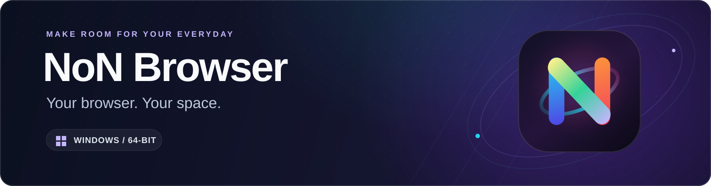

  

<h2 align="center">ดาวน์โหลด NoN Browser สำหรับ Windows</h2>

  เบราว์เซอร์สำหรับทุกวันของคุณ พร้อมอัปเดตเบื้องหลังและพื้นที่การท่องเว็บในแบบของคุณ

  
  
  

  
  &nbsp;
  

  <strong>รุ่นติดตั้ง</strong> แนะนำสำหรับใช้งานประจำ &nbsp;·&nbsp; <strong>Portable</strong> เปิดใช้ได้โดยไม่ต้องติดตั้ง

  <a href="https://github.com/nonthawat2548/NoN_Browser-Releases/releases/latest">ดูว่ารุ่นล่าสุดมีอะไรใหม่</a>
  &nbsp;·&nbsp;
  <a href="https://github.com/nonthawat2548/NoN_Browser-Releases/releases">ดูทุกรุ่นที่เผยแพร่</a>

---

---

  แหล่งดาวน์โหลดอย่างเป็นทางการของ NoN Browser · Windows desktop browser

